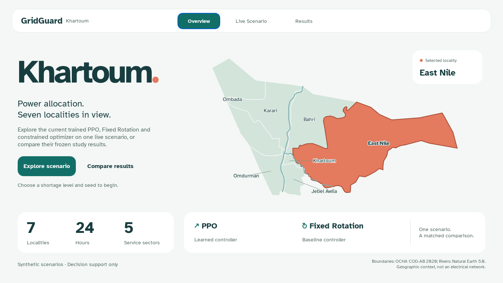
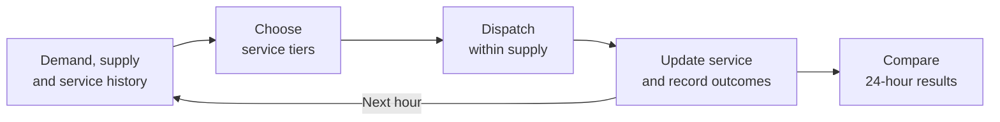
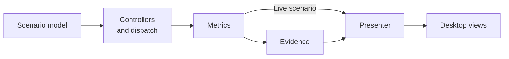

# GridGuard Khartoum

GridGuard studies electricity allocation across seven Khartoum State localities through
24-hour simulation, demand forecasting, reinforcement learning and an offline application.

A Bachelor of Computer Science graduation project, University of Khartoum,
Faculty of Mathematical Sciences and Informatics.

[Thesis](output/pdf/updated/gridguard-khartoum-thesis.pdf) ·
[Presentation](output/pdf/updated/gridguard-khartoum-project-presentation.pdf) ·
[Application pages](output/pdf/gridguard-khartoum-gui-pages.pdf) ·
[Editable thesis](output/documents/updated/gridguard-khartoum-thesis.docx)



## Research question

Can a learned policy distribute service more fairly while protecting essential demand
and using electricity efficiently?

Five sectors—Hospital, Water, Bakery, Residential and Commercial—face Mild, Moderate and
Severe shortages. Localities receive Off, Critical Only or Full Service. PPO and
Constrained Optimization share feasible actions and critical-service protection;
Fixed Rotation supplies the schedule baseline.



A separate Ridge AR(3) study evaluates forecasting; controllers do not use its predictions.

## Results

The main experiment compares controllers on 960 matched conditions. PPO values average
five independently trained, validation-selected policies.

| Controller | Served energy (MWh/day) | Critical interruption (locality-h) | Jain fairness | Utilization |
| --- | ---: | ---: | ---: | ---: |
| Fixed Rotation | 4,551.33 | 102.05 | 87.76% | 71.23% |
| Constrained Optimization | 6,547.90 | 0.00 | 94.78% | 97.41% |
| PPO | 6,528.02 | 0.00 | 97.02% | 97.02% |

PPO improves fairness and daily reward over the current-hour optimizer, but serves
19.88 fewer MWh per day and switches more often. Its utilization loss means the full
declared improvement criterion is not met. Critical protection comes from the shared
constraint; it should not be attributed to learning alone.

Further comparisons show that Fairness Rule obtains about 80% of PPO's reward advantage
over the optimizer without training, and meets the numerical service criteria in a
post-hoc assessment. A training-fitted hourly demand profile also outperforms Ridge AR(3).
The [research guide](docs/REVIEWER_GUIDE.md) separates these later analyses from the main study.

Demand and supply are synthetic; this is decision-support research without operational
validation on Khartoum's electrical network.

## Run the application

See [setup and reproduction](SUBMISSION_README.md) for requirements and experiment commands.

```powershell
uv sync --locked --extra dev --extra docs
uv run --no-sync gridguard-desktop
```

Inspect locality timelines in Live Scenario; browse the saved study in Results.

## Code and experiments



| Directory | Contents |
| --- | --- |
| `src/gridguard/` | Simulation, controllers, forecasting and desktop application |
| `tests/` | Scientific, interface and packaging tests |
| `data/` | Study results and trained policy weights |
| `docs/` | Thesis source, experiment protocols and figures |
| `tools/`, `scripts/`, `packaging/` | Experiment, document and application build commands |
| `output/` | Thesis, presentation and application-page documents |

## Authors

Murtada Asim Ibrahim Bakhit · Suliman Elawad Suliman Babiker ·
Abdalhay Abass Mobarak Abass

Supervised by **Dr. Abubakr Siraj** · October 2026
